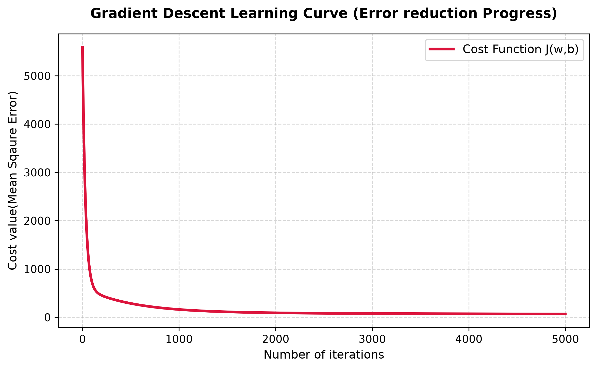

# Simple House Price Predictor (From Scratch) 🏡

A simple Python model built from scratch using raw math to predict house prices in Bengaluru based on **Square Footage**, **BHK**, and **Bathrooms**. 

Instead of using libraries like `scikit-learn`, this calculates the errors and updates its own parameters manually using Gradient Descent matrix math.

---

## 🛠️ How it Works

1. **Data Cleaning:** Automatically removes commas, extracts digits from strings like `"3 BHK"`, and deletes missing data using `pandas`.
2. **Min-Max Scaling:** Squeezes all input values between `0` and `1` so the different sizes don't confuse the model.
3. **Math Engine:** Runs a loop that checks how wrong the guesses are, calculates partial derivatives, and adjusts the weights step-by-step.
4. **Real-Time Predictor:** Takes normal input values from a user, scales them instantly, and outputs a real-world price in Lakhs.

---

## 📊 Key Results (5,000 Iterations)

* **Cost Reduction:** Dropped sharply from a starting error of `5592.77` down to a flat `68.25`.
* **Model Accuracy (RMSE):** `₹11.68 Lakhs` (On average, the model's price guess is off by only this much).
* **Live Test:** An 1,800 SqFt, 3 BHK, 3 Bath apartment is valued at **₹98.32 Lakhs**.

### Error Reduction Plot
The script automatically saves a graph (`learning_curve.png`) showing the error line flattening out perfectly as the model learns:

---

## 💻 "Tech Stack"
* **Language:** Python
* **Libraries:** NumPy, Pandas, Matplotlib
